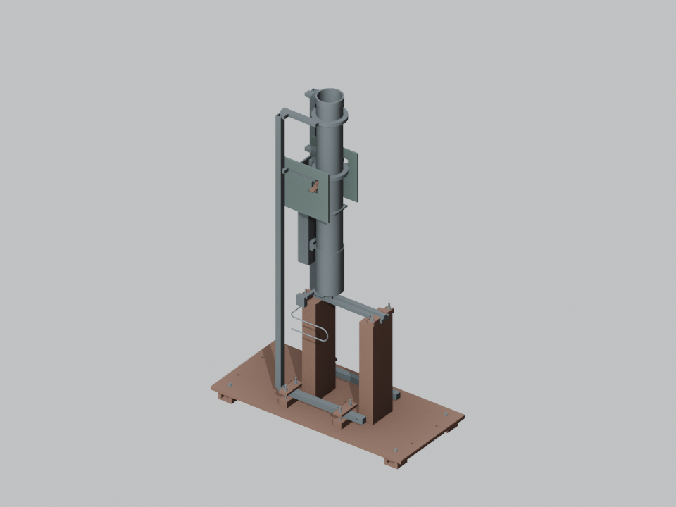

# BM1 羽毛球发球机 · V0.2 / R3

BM1 羽毛球发球机的参数化数字工程项目：以 `data/` 为唯一几何参数来源，使用 CadQuery 建立原生实体，使用 Blender 制作展示场景和动画，保留 `ASM-xx`、`PRT-xxxx` 编号。

**当前版本是工程评审候选包，尚未完成制造放行、实物采购、加工或样机试验。** 上夹驱动适配与导向、实际采购件接口、紧固载荷及台面锚固仍待确认。数字检查通过不能替代实物验证。



## 下载与查看

- [完整 R3 交付包及 SHA-256 校验文件](https://github.com/LYCMYT/faqiuji/releases/tag/v0.2-r3)
- [R1 中文总装图册](output/BM1_V0_design_book.pdf)
- [R2 球样与加工准备说明](output/prototype_r2/BM1_R2_sample_manufacturing_manual.pdf)
- [R3 连接与加工图集](output/fixture_r3/BM1_R3_connection_drawing_book.pdf)
- [R3 连接件分解动画](output/fixture_r3/BM1_R3_connections_explode.mp4)
- [R1 验收报告](reports/acceptance_report.md) · [R2 验收报告](reports/r2_acceptance_report.md) · [R3 验收报告](reports/r3_acceptance_report.md)

克隆后，在安装了 Python 的 Windows 上双击 `启动查看器.cmd`。也可以在项目根目录运行：

```powershell
python tools/serve_viewer.py --open
```

服务仅绑定本机。总装地址为 `http://127.0.0.1:8765/viewer/`，R3台架地址为 `http://127.0.0.1:8765/output/fixture_r3/viewer.html`。网页依赖已本地化；请通过本地服务访问，不直接用 `file://` 打开。

## 交付范围

| 阶段 | 内容 | 当前状态 |
|---|---|---|
| R1 总装 | 44主项、10个功能子总成、189原生实体实例；总装/逐件STEP、BLEND、GLB、152页图册及三段动画 | 数字工程检查完成；实际性能未验证 |
| R2 样机准备 | 72只计划球样、44项工艺路线、8件无孔试配毛件、22页说明和空白测量表 | 球样未采购；所有测量结果为空 |
| R3 连接细化 | 独立低速台架155实例、71份STEP、21份DXF和零件图、53行孔表、43页图集、BLEND/GLB与分解动画 | 235个指定位置、24处指定工具通道检查通过；接口及承载未全部冻结 |

R1的189实例含187个物理实例及2个独立羽毛球参考实体。R3是单独的低速试验台变体，不是将R3检查结果套用于整机。检查范围、排除项、采样限制及未决问题均见各版验收报告。

必须保留的关系包括：双轮仅作用于球头；导套先回缩、托架前移脱筒后再转头；固定供球器与机头基座共同手动升降；机头采用前宽后窄、后部抬高的阶梯骨架；夹持释放使用几何动作；轮组捕获后羽毛球解除与托架的刚性绑定。

## 目录

| 目录 | 用途 |
|---|---|
| `data/` | 参数、零件、关节、接口、状态与各次修订选择 |
| `cad/` | CadQuery原生实体、装配和运动关系 |
| `blender/` | 展示场景、材质、镜头、动画和交换模型 |
| `control/`、`engineering/` | 离线反馈合同模拟、质量及支承计算；不直接连接硬件 |
| `tools/`、`tests/` | 重建、检查、导出、打包及回归测试 |
| `output/` | STEP、图册、图页、视频、BLEND、GLB与试验准备资料 |
| `reports/` | 验证结果、冲突修订记录、独立复核和验收边界 |
| `viewer/` | 本地三维查看器及其依赖 |
| `input/` | 保留的原始设计包内容 |
| `licenses/` | 已随工程保留的第三方许可资料 |

## 重建

已使用的环境：Windows、Python 3.12、CadQuery 2.8、Blender 4.5.9 LTS；另需 FFmpeg 和 Chrome 完成视频与查看器检查。渲染及图册脚本使用 Windows 中文字体。运行时安装包、虚拟环境、缓存和原始动画帧不进入仓库。

```powershell
py -3.12 -m venv .venv
.venv/Scripts/python.exe -m pip install -r requirements-lock.txt
$env:BM1_BLENDER_EXE = 'C:/Program Files/Blender Foundation/Blender 4.5/blender.exe'
.venv/Scripts/python.exe tools/rebuild.py
```

将 Blender 路径改为实际安装路径，并保证 `ffmpeg` 可在 PATH 中找到。完整重建会生成所有阶段产物并执行检查，耗时取决于机器。分阶段命令见 [详细交付说明](README_DELIVERY.md)。

现有回归测试：

```powershell
.venv/Scripts/python.exe -m unittest discover -s tests
```

不要将唯一实测记录填写到会被重建覆盖的 `PLAN`/`BLANK` 模板中；请另存实测副本。未选型、未实测的容量、转速上限、落点精度及安全等级继续保持未知。
