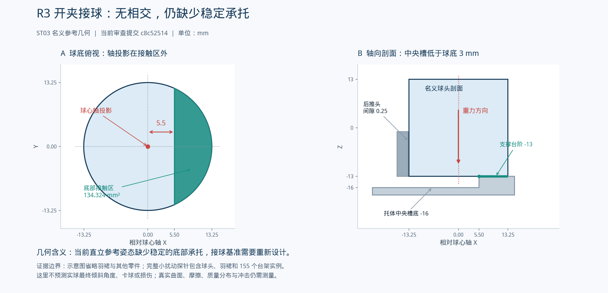

# BM1 R3 仓库审查与后续研发规划

**审查基准：** [LYCMYT/faqiuji @ c8c52514](https://github.com/LYCMYT/faqiuji/tree/c8c52514a80f52c364950852ed2fde2a1d926e62)；`main`，标签 `v0.2-r3`。审查日期：2026-10-26（Asia/Shanghai）。

## 1. 核心判断

项目已从图文概念方案进入“参数化工程候选模型与低速样机准备”阶段。R1整机、R2球样/工艺准备、R3连接细化都有实际文件，具有继续使用的基础。当前不需要重做全部模型，也不应根据文件规模推断硬件已经成立。

**建议下一版定为 R4：可信的构建与控制合同 + 有明确接球基准、导向和连接的低速台架。** 先处理本次发现的缺陷，再取得球样、供应商图纸与首件数据。R3本身不含高速轮，不能把R3台架检查当作前后场发球能力验证。

最关键的新问题是：

1. 开夹落球时，参考球的重力投影不在承托接触区内，给定的直立姿态缺少稳定约束。
2. 4个料号的工艺/采购路线与实际部件功能不符，已经传播到询价表。
3. 离线状态机在导套下位或下闸闭合丢失后仍可能继续，部分字符串输入还可被当作真值。
4. 日常重建会覆写部分权威输入，报告来源指纹不完整，单点静态PASS能满足完整交付的部分门禁。

这些问题都可以在现有架构上逐项修正。当前仓库明确保持制造未放行、实测为空，这一边界应继续保留。

## 2. 本次实际检查了什么

### 2.1 版本与远端状态

通过用户指定的 GitHub 连接读取仓库元信息、目录树、README、验收报告、提交、分支、发布、Issues和Actions运行记录；只读克隆指定提交后审查本地源码。读取时仓库只有一个 `main` 分支和一个初始提交；存在 `v0.2-r3` 发布，远端Actions运行数为0，Issues列表为空。该状态只描述本次读取时点，不代表之后不会更新。

发布附件包括完整R3 ZIP及其SHA-256文件。本次核对的是仓库内交付清单与实际文件，**没有重新下载并校验74 MB发布ZIP的每个字节**，不把两种检查混为一谈。

### 2.2 独立验证结果

| 检查 | 本次实际结果 | 适用范围 |
|---|---|---|
| 交付清单复算 | 1,806项，大小与SHA-256全部匹配，缺失0、变化0 | 证明当前清单与文件一致，不证明报告由全部当前输入生成 |
| 原有单元测试 | 18项通过；完整日志见附件 | 只覆盖现有测试定义，新增反例仍可失败 |
| R3原检查器完整复跑 | 155实例、8种夹块变体、235指定状态、793次精确相交计算；0未解释体积相交 | 本次执行环境下原脚本声明的离散状态与工具通道检查 |
| R3静态诊断复跑 | 1状态、179次精确相交计算，仍输出同名PASS报告 | 用于验证静态/完整范围门禁缺口 |
| STEP回读 | 80份通过有效实体/正体积检查 | R3的71份、R2的8份和R1整机1份；未声称回读全部222份STEP |
| DXF回读 | 29份闭合轮廓可拉伸 | R3的21份另与相应STEP顶面面积比较，差值在原0.02 mm²阈值内；不证明孔深、公差或工艺 |
| PDF结构检查 | 152、18、22、43页，均可提取文字 | 不是本轮逐页人工设计审核；查看了R3整体与拆解示意 |
| 控制新反例 | 7组问题复现 | 离线合同，无硬件输出 |
| 接球几何探针 | 接触区与重力投影错位、小角度后倾存在可行空间 | 当前理想参考几何，未做真实球动力学 |
| 输入覆写/来源/门禁探针 | 指定问题复现 | 临时副本、内存或原AST谓词测试；未改仓库 |

本机为 Python 3.12、CadQuery 2.7.0、OCCT 7.8.1.1.post1。仓库记录为 Windows、Python3.12.10、CadQuery2.8.0、OCCT7.9.3.1、Blender4.5.9 LTS。本机没有Blender和Chrome，因此**没有声称完整锁定环境重建、浏览器交互或全部动画渲染已在本轮重验**。

原仓已跟踪文件在检查前后无变化。隔离副本运行结果与独立探针存入本包 `evidence/`。

### 2.3 应保留的已有成果

- R1：44主项、10功能总成、189原生实例，其中187个物理实例、2个参考对象；参数实体、交换文件、图册与离线控制合同已经存在。
- R2：72只计划球样、4种夹块半径、工艺路线、测量和筛选表已编制。72是采购计划数，不是已收到样品数。
- R3：155实例低速台架、71份STEP、21份DXF、53行孔位表、43页连接图集，以及真实的冲突修订记录。
- 维护后抽、线缆候选路径、部分反馈丢失锁定、出球脉冲条件、实测为空时阻断质量结论等工作可以继续复用。

来源：[仓库README](https://github.com/LYCMYT/faqiuji/blob/c8c52514a80f52c364950852ed2fde2a1d926e62/README.md)、[R1验收](https://github.com/LYCMYT/faqiuji/blob/c8c52514a80f52c364950852ed2fde2a1d926e62/reports/acceptance_report.md)、[R2验收](https://github.com/LYCMYT/faqiuji/blob/c8c52514a80f52c364950852ed2fde2a1d926e62/reports/r2_acceptance_report.md)、[R3验收](https://github.com/LYCMYT/faqiuji/blob/c8c52514a80f52c364950852ed2fde2a1d926e62/reports/r3_acceptance_report.md)。

## 3. 新发现与影响

优先级含义：P1为进入相关采购、自动运动或新版本验收前必须解决；P2为下一阶段工程可靠性完善。这里没有把离线反例写成已发生的实机事故，也未用P0夸大证据。

### M01 / P1：开夹接球缺少稳定承托

**来源：** [geometry.json的托体与推头](https://github.com/LYCMYT/faqiuji/blob/c8c52514a80f52c364950852ed2fde2a1d926e62/data/geometry.json#L1630-L1688)、[参考球](https://github.com/LYCMYT/faqiuji/blob/c8c52514a80f52c364950852ed2fde2a1d926e62/data/geometry.json#L6811-L6852)、[ST03落球姿态](https://github.com/LYCMYT/faqiuji/blob/c8c52514a80f52c364950852ed2fde2a1d926e62/data/demo_states.json#L63-L72)。

在ST03开夹、导套下位、滑台装载位时，名义球头底面为Z=-13 mm，球心轴X=-190 mm。低位托体中央槽切到Z=-16 mm，球底只接触前侧的一段圆弓形支撑区：

| 几何量 | 本次计算 |
|---|---:|
| 唯一底部接触面积 | 134.323918 mm² |
| 支撑区X范围 | -184.5至-176.75 mm |
| 球心轴投影X | -190 mm |
| 轴投影与最近支撑边缘距离 | 5.5 mm |
| 后推头间隙 | 0.25 mm |
| 开夹时左右夹指间隙 | 各14 mm |

轴对称参考球的重力投影落在支撑接触区外。把参考球头和羽裙整体绕台阶边缘后倾1°，对155个台架实例没有超过0.01 mm³的相交，球头中心下降约0.098 mm；2°才开始碰到后推头。接触面积同时由解析圆弓形公式核对。

这说明现有动画给定的直立接球姿态不是靠名义接触几何稳定保持的。碰撞检查只证明给定姿态没有互穿，无法证明球会停在那里。**实际球最后如何倾斜、是否被推头重新定位、是否损伤，仍要实测；本次没有断言实物必然卡球。**

R4应先明确球头承托和就位基准，再设计闭夹与释放。可评估低位浅窝、分段承托或装载位可撤回支撑，但必须同时核对夹指运动、滚轮下方避让和释放路径，不能简单填平中央槽。证据：`support_evidence.json`和示意图。

### D01 / P1：4个料号的工艺与采购路线错误

**来源：** [r2_process_routes.json](https://github.com/LYCMYT/faqiuji/blob/c8c52514a80f52c364950852ed2fde2a1d926e62/data/r2_process_routes.json#L17-L42)、[零件主数据](https://github.com/LYCMYT/faqiuji/blob/c8c52514a80f52c364950852ed2fde2a1d926e62/data/parts.json)、[已生成询价表](https://github.com/LYCMYT/faqiuji/blob/c8c52514a80f52c364950852ed2fde2a1d926e62/output/prototype_r2/manufacturing_routes_44_RFQ.csv)。

| 料号 | 实际功能 | 现有错误路线 | 应修正的方向 |
|---|---|---|---|
| PRT-0402 | 俯仰短耳轴 | 扇形板或制动组件 | 短轴/耳轴、轴承及连接配合；材料/强度后确认 |
| PRT-0702 | 低位定位夹 | 机械限位块 | 无损夹持接触件、导向和开合连接 |
| PRT-0704 | 托球夹释放执行器 | 滑台执行器及耐弯电缆 | 夹持释放驱动、连杆、反馈和行程 |
| PRT-0903 | 配电与联锁箱 | 辅助电机驱动 | 配电、停止链和联锁功能的组件拆分 |

这些错配已从源数据传播到RFQ，不能直接发送当前44项路线作为准确采购需求。保持料号不变，修正角色、功能与路线，并重新生成受影响的询价表和手册。

### C01 / P1：关键反馈丢失后仍可能继续供球动作

**来源：** [feed_cycle.py](https://github.com/LYCMYT/faqiuji/blob/c8c52514a80f52c364950852ed2fde2a1d926e62/control/feed_cycle.py#L17-L89)。

从IDLE按正常路径进入RETAIN后，把guide_down和guide_up都设为False，保持upper_held和gate_closed为True，下一拍实际输出为DROP、gate_target=open、enable_motion=True、fault=None。

另一条正常路径到GATE_CLOSE→GRIP后，上层留球输出已经为open；下一拍下闸又回到开位，仍可以GRIP→GUIDE_UP。代码没有覆盖这一持续保持条件。

修复不能只加一处转移条件。应建立“每个状态必须持续成立的反馈”表，先验证不变量，再输出下一动作。导套引导、上层留球、下闸承托之间的保持交接要有明确条件。

### C02 / P1：输入类型、时间和运动范围没有统一校验

同一控制文件已对部分字段使用严格bool检查，但其他条件依赖Python真值判断。已复现 `start="false"` 能启动、`guide_down="false"` 能进入RETAIN、`upper_held="false"` 能推进开闸。

`dt=True` 被当成1秒；`dt=None`或字符串会在`math.isfinite()`抛异常，未进入统一故障状态。另在 [kinematics.py](https://github.com/LYCMYT/faqiuji/blob/c8c52514a80f52c364950852ed2fde2a1d926e62/cad/assemblies/kinematics.py#L38-L54) 中，`permitted()`可对NaN、空滑台1000 mm、yaw180°/pitch80°返回True。该函数实际只覆盖部分相对互锁，不是完整运动许可。

R4先建立输入schema、有限数/非bool数字校验、轴范围和可达性检查，再讨论真实通信或语音。`permitted()`若继续保留原名，应能给出完整拒绝原因；否则应明确重命名为部分互锁函数，并在调用层补齐许可。

### C03 / P2：旧信号保护与已经到位的合法命令冲突

当前到位要求统一低→高。零偏航/零俯仰时，head_home可能一直为True。已复现正常出球后流程进入HOME，却因没有新的低→高边沿而超时。

应将“当前在目标容差内”与“本次命令已经完成”区分，使用命令编号/完成编号或明确握手。既要拒绝旧完成事件，也要允许目标本来就在当前位置的有效完成。

### T01 / P2：两项测试因无关错误提前故障而通过

**来源：** [test_r1.py](https://github.com/LYCMYT/faqiuji/blob/c8c52514a80f52c364950852ed2fde2a1d926e62/tests/test_r1.py#L30-L87)。

- 捕获常高测试缺少exit字段，实际故障为`exit_feedback_missing_or_invalid`。
- 持球丢失测试缺少slide_clear，实际故障为`arrival_feedback_missing_slide_clear`。

补齐无关输入后，现有代码会触发预期保护，因此不能说这两个保护本身失效。问题在于测试只断言FAULT，没有验证预期故障路径。应以每个状态完整合法输入为基线，单项改变并断言准确fault。

### B01 / P1：日常重建覆写输入，可能清空后续采购与材料证据

**来源：** [rebuild.py](https://github.com/LYCMYT/faqiuji/blob/c8c52514a80f52c364950852ed2fde2a1d926e62/tools/rebuild.py#L11-L19)、[enrich_metadata.py](https://github.com/LYCMYT/faqiuji/blob/c8c52514a80f52c364950852ed2fde2a1d926e62/tools/enrich_metadata.py#L6-L27)。

碰撞检查之后，enrich_metadata重建并覆写contact_pairs.json；它也将materials.json的密度、供应商型号写回null、状态写回concept，并重写interfaces中的状态。

临时副本放入可辨认的材料/接触标记后，运行原脚本，标记被默认值覆盖，进程正常退出。这是对未来证据可被覆盖的确定复现，**不是声称当前已丢失真实采购数据**；当前原始实测本来为空。

应分开权威输入、人工证据和生成结果。日常重建结束后输入哈希必须与开始时一致；默认值初始化作为单独命令。

### B02 / P1：报告与模型缺少完整来源对应

**来源：** [运动参数与几何](https://github.com/LYCMYT/faqiuji/blob/c8c52514a80f52c364950852ed2fde2a1d926e62/cad/assemblies/kinematics.py)、[最终报告来源判断](https://github.com/LYCMYT/faqiuji/blob/c8c52514a80f52c364950852ed2fde2a1d926e62/tools/final_report.py)、[R3检查器](https://github.com/LYCMYT/faqiuji/blob/c8c52514a80f52c364950852ed2fde2a1d926e62/tools/check_r3_geometry.py)。

R1只用geometry.json的哈希判断“当前几何”，而实体还依赖design.json、parts.json、关节代码、形状生成器和接触规则。R3报告没有同等级的来源指纹。

内存探针把轮距25改成30，左轮中心Y从82.5移到85.0 mm，但现有geometry_sha256匹配条件仍为True。这不说明现有模型错误，说明该一致性判据无法检测这类输入改变。

应把输入文件集合、相关源码、工具版本、检查范围与输出哈希绑定到同一个run_id。缓存也使用同一来源标识。当前1,806项文件哈希匹配与这个问题并不矛盾：前者校验文件完整，后者校验结果由什么产生。

### B03 / P1：单点静态PASS能替代完整运动检查结果

**来源：** [check_r3_geometry.py](https://github.com/LYCMYT/faqiuji/blob/c8c52514a80f52c364950852ed2fde2a1d926e62/tools/check_r3_geometry.py#L11-L71)、[build_r3_package.py](https://github.com/LYCMYT/faqiuji/blob/c8c52514a80f52c364950852ed2fde2a1d926e62/tools/build_r3_package.py#L12-L13)、[finish_r3_delivery.py](https://github.com/LYCMYT/faqiuji/blob/c8c52514a80f52c364950852ed2fde2a1d926e62/tools/finish_r3_delivery.py#L47-L50)。

`--static`跳过运动，仍把同名报告写为PASS，并保留描述运动范围的文字。导出门禁只看PASS。本次在隔离副本实际得到1状态PASS，该结果满足现有准入表达式。

另有三项检查缺口：最终门禁只比对Blender网格数而不检查blend_reopened/glb_reopened/ids_preserved；STEP最终检查只遍历已有文件，不核对完整期望集合；夹指路径由2 mm开始，未明确覆盖该路径下clamp=0端点。

当前235点完整检查已在本轮复跑通过，**不能据门禁缺口指称现有报告造假**。R4应让“检查未执行”与“执行后无问题”成为不同状态，静态诊断不能发布完整交付。

默认完整rebuild调用未带`--static`，会执行完整R3检查；本缺口位于分阶段执行或旧报告复用时的准入校验。

### B04 / P1：Blender异常与旧报告的组合风险

[tools/rebuild.py:10](https://github.com/LYCMYT/faqiuji/blob/c8c52514a80f52c364950852ed2fde2a1d926e62/tools/rebuild.py#L10)仅使用`--background --python`，没有`--python-exit-code`。Blender4.5官方文档说明该参数控制命令行Python异常的退出码，零值禁用。因此仅依赖subprocess的check=True不足以保证脚本异常传递给父进程。[官方文档](https://docs.blender.org/manual/es/4.5/advanced/command_line/arguments.html)

如果旧报告仍在，后续又不核对run_id和真实回读字段，就可能继续接受旧结果。本机没有Blender，**此项是源码与官方语义确认，未进行完整Blender异常链复现**。

R4统一启用非零Python异常退出码，运行前使对应旧结果失效，成功后原子写入新报告；后续只接受同一run_id。

### B05 / P2：报告会自动重复声称未重新完成的证据

**来源：** [check_r1_delivery.py:40](https://github.com/LYCMYT/faqiuji/blob/c8c52514a80f52c364950852ed2fde2a1d926e62/tools/check_r1_delivery.py#L40)、[final_report.py](https://github.com/LYCMYT/faqiuji/blob/c8c52514a80f52c364950852ed2fde2a1d926e62/tools/final_report.py)、[r1_report_text.py](https://github.com/LYCMYT/faqiuji/blob/c8c52514a80f52c364950852ed2fde2a1d926e62/tools/r1_report_text.py)。

自动脚本直接写“全部联系表已人工查看”；环境版本为固定字符串；验收报告先于单元测试生成却写固定18项通过。R2/R3部分验收Markdown也没有随重建重新生成。

这不否定此前人工审核可能实际发生。确定问题是：新产物可以自动继承旧措辞。应从本次结果生成测试数和环境，人工审核单独绑定审核人、时间、产物哈希；未完成就显示未完成。

### A01 / P2：质量证据入口和通用支承算法仍需修正

**来源：** [engineering/evaluate.py](https://github.com/LYCMYT/faqiuji/blob/c8c52514a80f52c364950852ed2fde2a1d926e62/engineering/evaluate.py)。

当前默认实测为空会正确阻断结果，但填写数据后有入口缺口：重复instance_id重复计质量；True被当作1 kg；source为空只要状态字符串符合即可显示INPUT_EVIDENCE_PRESENT；调用者省略未测实例后，函数无法判断整机是否完整。

通用支承算法只删除负反力支点，不允许重新接触。五支点反例中平衡残差接近零，但漏掉一个应有约13.798 N反力的支点。完整输入及独立枚举结果见附件。**默认BM1是四个矩形支点，本次没有证明其默认姿态已经算错。**

R4应验证实例集合、唯一性、非布尔有限数及证据链接；支承计算验证单向接触互补条件。也可以暂将函数支持范围明确限制到已验证的模型，不继续接受没有正确算法支持的通用输入。计算通过仍不等于整机稳定性通过。

## 4. 仓库已经声明的未决问题

这些不是本次新增缺陷，需继续保留而不能重复包装成新发现：

| 开放项 | 当前具体缺什么 | 关闭证据 |
|---|---|---|
| R3-O01 上夹导向/驱动 | 自定义销孔存在，但托板导向、驱动适配与反力路径不完整 | 实际机构图、导向与行程、样件力和装配检查 |
| R3-O02 实际滑台兼容 | 侧压爪只对应候选轨底 | 真实型号图、允许夹持区、滑块包络和负载 |
| R3-O03 预紧与防松 | 紧固等级、连接载荷、POM变形尚无证据 | 连接分析、材料/紧固件确认、首件预紧与复检 |
| R3-O04 台面锚固 | 台面、背板、螺栓长度及支承条件未确定 | 实际台面信息、装配和承载/刚度记录 |
| R3-O05 内部其余连接 | 下闸、导套执行器、连杆、筒架节点仍属候选 | 五轴约束表、实际连接图和逐项试装 |
| U01–U10 | 真实球、翻转、轮缘、供球、释放、线束、稳定、电气、接口、球路 | 各自供应商与实测证据，不能批量自动关闭 |

五个低速运动功能是：上夹、下闸、导套、接球滑台、接球夹。当前代码的独立平移不等于机械导向已经完成。上夹24 mm与接球夹14 mm是**每侧**位移，双夹开口变化分别48 mm和28 mm；执行器自身行程仍取决于传动比和适配方案。

来源：[r3_work_instructions.json](https://github.com/LYCMYT/faqiuji/blob/c8c52514a80f52c364950852ed2fde2a1d926e62/data/r3_work_instructions.json)、[joints.json](https://github.com/LYCMYT/faqiuji/blob/c8c52514a80f52c364950852ed2fde2a1d926e62/data/joints.json)、[R3验收边界](https://github.com/LYCMYT/faqiuji/blob/c8c52514a80f52c364950852ed2fde2a1d926e62/reports/r3_acceptance_report.md)。

## 5. 后续路线与每一阶段的完成定义

### R4-A：让数字结果可复查

先修正料号路线、连续互锁、严格输入、已到位命令、构建输入覆写和完整来源。随后加入R3完整范围门禁、实际测试驱动报告和最小CI。建议拆成独立PR，不能用一次巨大提交掩盖不同问题。

**完成定义：** 原有功能保持；本包反例转为针对性回归后通过；故意失败的构建不能打包为合格；输入和实测证据不被重建改写；清空派生产物后可在支持的Windows环境重新生成核心模型并完成检查。

### R4-B：完成低速台架的机械闭环

复用现有R3基板、连接变体与可换夹块。先解决M01接球基准，再给五个低速功能建立真实导向、连接、限位和反力路径。

推荐先设计“独立导向 + 受控人工操作”的低速验证模式，用实际位移/力/损伤结果确定执行器需求；手动模式也要有机械保持、夹点隔离、停止和装载规程。若已有合适执行器和原厂图，可直接设计适配，但不要靠虚构力矩选型。

R4可以先批准特定试配件或低速夹具的首件范围；整机manufacturing_release继续为false。低速台架局部height=0坐标不能与整机H=1400–1800直接混用。

**数字候选完成：** 名义模型的接球支撑、五个功能的导向与连接、限位和反力路径可审查；图纸包含已确定的材料、基准、孔深和版次，缺失采购接口明确列为OPEN。**首件准入另要求**真实采购接口完成核对，机械合作者确认装配、锚固与操作范围。

### R4-C：收集第一批真实球样和低速循环数据

沿用现有R2计划：AS-30 36只、AS-10 24只、MAVIS350 12只；实际批次、速度标识和到货数量按收货记录填写。天然羽毛球为主验证，尼龙球兼容性独立统计。

先测球头、羽裙、质量、套叠节距和取球力，再做R23/R26/R29/R32试配。保留1/3/6只堆叠条件和封存样本复核。**当前R29只是展示候选，不能因为模型用了R29就提前宣布它是最终方案。**

筛选数据必须包含：单球、双球、空发、卡住、回弹、接球姿态、夹持/释放力、羽毛和球头损伤、人工干预和原始视频。选择参数后，用封存12只的计划300次循环复核；重复使用小样本不等于300个独立样本或量产可靠性。

建议门槛是：每个故障必须可发现和停止；选定条件能够重复完成单球分离与稳定接球；记录有效球/全部请求及人工干预。成功率目标应在首轮力与尺寸数据取得后冻结，不能为达到某个百分比删掉失败或改变分母。

**完成定义：** 至少一个声明清楚的球种/球况/装载范围形成真实可复查结果，明确继续、修改还是终止此分球方案。

### R5：单独验证高速发射与前后场球路

R3没有高速轮，不能跳过此阶段。建立独立单球发射台架，复用已经验证的接球和释放基准；依据真实轮缘/轮毂/主轴资料确定工作条件，再验证防护、转速反馈、停止和供球。

先观察最短前场路径中的离轮转正，再评估后场深度。记录左右实际转速、轮距、俯仰、球况、释放位置、轨迹、落点和损伤。转速或角度的一个数字不能代表训练可用性。

**完成定义：** 在声明的参数范围内形成前场与后场可重复预设，真实捕获/释放窗口与停止距离有数据；未通过时返回核心机构，不继续整机扩容。

### R6：整机、四角训练与标定

整合高度、偏航、俯仰和供球，核对实际整机质量、各姿态的支承与线束。先固定四点，再前后/左右交替。每个预设同时定义落点区、过网/击球区高度、时间与节拍。

分别报告供球成功率、成功发射后的命中率、全部请求中的总有效球率。标定数据绑定球种、磨损、出球高度、环境与硬件版本。机器必须在本地按钮控制下独立完成训练与故障恢复，再把语音接入。

### R7：实时对话与训练调整

对话界面可提前用模拟器开发。实机接入时只调用已验证预设或受限调整。每个命令带request_id/cycle_id，区分received/queued/applied/rejected/fault；收到applied后才能回复“已调整”。

现有FeedCycle只有单周期离线合同，没有真实GPIO/通信、连续发球调度、正常暂停/恢复接口或语音；这些是后续范围，不是当前固件已有功能。硬件故障、复位或重连后不自动继续训练。

## 6. 接下来两周怎样安排

以下为资源安排建议，不是保证工期；按一位软件/Codex执行者与一位机械合作者可并行工作估计。

| 时间窗口 | 数字工作 | 实物/机械工作 | 结束时应拿到什么 |
|---|---|---|---|
| 第1–2个工作日 | 固定基准；修正4料号；把反例加入测试；建立输入/派生目录规则 | 确认测试场地、台面、现有工具与球种 | 问题均可复现，修订范围与负责人明确 |
| 第3–5个工作日 | 严格输入、连续互锁、命令完成逻辑；构建失败退出与来源标识 | 接球支撑方案比较、五轴导向/连接草案 | R4-A核心缺陷修复，R4-B方案可评审 |
| 第2周 | 完整门禁、报告/CI、测量档案入口；复核修订CAD | 取得真实采购图和报价；球样收货/测量；机械审查 | 数字基线可重复，首批台架件有具体询价与首件范围 |
| 随后按交期 | 数据记录、低速控制联调 | 首件、试装、人工低速试验、筛选与复核 | 决定供球方案是否进入R5 |

只有一位执行者时按顺序推进。真实型号、测力、报价和加工交期会影响后续安排，不能让Codex补造这些输入以赶上日期。

## 7. 预算与投入顺序

仓库的报价、订单、到货与实测字段为空。因此目前不能把此前讨论的6,000–12,000元整机估算，或约3,000元首轮讨论上限，当成R3的有效报价。R3有21个自制/修改件族图页及更多实际实例，当前没有证据说明其全部加工可以压在那个上限内。

建议按以下顺序支出，并用真实报价更新预算：

1. 球样与可借用的测量工具，取得尺寸和力的输入。
2. 修改后接球/夹块及导向接口的少量首件；不盲目同时加工未确认的全部候选。
3. 低速台架基板、支撑、真实导轨和连接件，含必要防护、锚固与操作空间。
4. 低速验证通过后再投入高速轴系、电机驱动与防护。
5. 球路通过后继续整机外罩、容量、便携和语音集成。

每次询价包含模型/图纸版本、材料、公差、数量、税运、交期、首件报告、返修条件；外包机械、电控与调试人工单列。预算不够时削减兼容范围、展示与扩容需求，不能删去必要的导向、连接、停止或测量。

## 8. 分工与当前最应做的决定

- 你：确认主训练球、场地与目标；组织样本、报价和真实试验，决定阶段投入。
- Codex：修正数据/代码、生成可重建模型、实现可复查检查与记录工具、分析原始结果。
- 机械合作者：接球基准、五轴导向/力路径、采购接口、加工与装配、锚固及承载。
- 电控合作者：真实I/O、驱动、保护、停止与反馈、低速联调；不能把离线enable字段直接视为合格实机停止回路。

**立即执行的数字工作是R4-A；立即推进的机械工作是接球承托和五轴连接审查。** 球样和供应商图纸可以并行准备。完整Codex任务与门槛见本包实施计划和下一条提示词。

## 9. 对结论的使用限制

本报告是源码、产物和指定数字探针的审查。尚未完成完整Windows锁定环境重建、实物测量、强度/疲劳、真实防护、停止时间或训练测试。发现已定位但未在本轮修改产品代码。后续提交应重新执行对应验证，并用新证据关闭问题；不能把本报告复制为新版本的通过证明。
